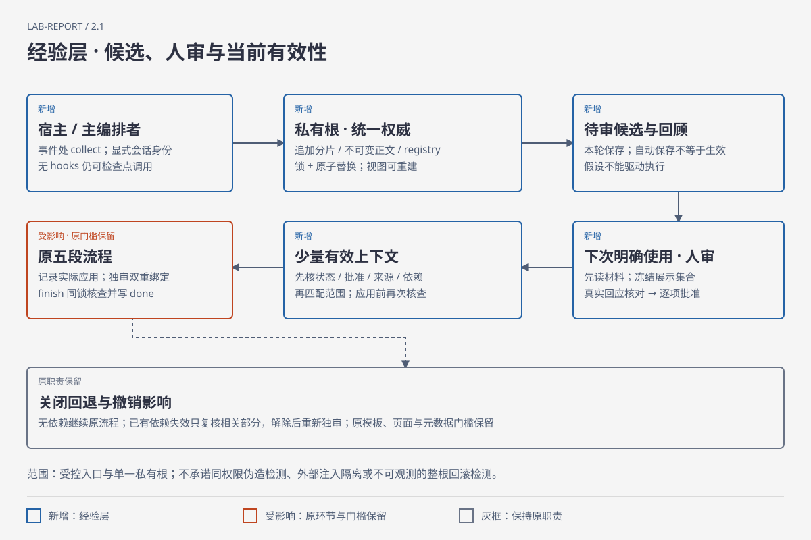

# lab-report

**把任务意图、真实证据和实验文档连起来。**

面向实验报告及实验论文的 Agent Skill，覆盖完整制作、已有文档审查和局部修改。不预设固定文档类型，而是从你给的要求、模板和范例提取可溯源意图，确认后自动推进。普通实验报告仍以截图与必要短文为主，论文按实际要求组织；它保护原模板，也不会凭空补出实验结果。

[开始使用](#开始使用) · [经验增强](#3-可选开启受监督经验) · [写作效果](#写作效果示意) · [环境依赖](references/portability.md) · [验证边界](docs/validation.md)


## 你提供什么，会得到什么

| 输入 | 处理方式 | 输出 |
| --- | --- | --- |
| 任务、模板、评分标准、补充要求与范例 | 先读全部材料，区分硬要求与参考风格，只澄清实际缺口 | 一份可追溯来源与理由的意图 Markdown |
| 已授权的代码、实验环境、日志与截图 | 复用环境、完成必要验证，区分真实运行和原因推断 | 真实证据与报告中的对应说明 |
| 新文档或已有 Word 文件 | 在副本允许区域写作或修改，由独立 Agent 对照原材料与确认意图审查，修订复核当前版本 | 可编辑 Word、要求的源码/数据、一份简短审核记录 |

PDF 仅在课程或用户要求时作为交付物。若只请求审查，输出问题和建议；若只请求排版，不因此重跑实验。原始模板与证据保留。

## 开始使用

### 1. 安装整个技能目录

先从本仓库下载 ZIP 并解压，或执行：

```sh
git clone https://github.com/2kilo3/lab-report.git
```

把完整目录复制到相应位置，保留 `SKILL.md`、`references/`、`scripts/`、`docs/` 和 `tests/` 的相对关系。目标已有同名技能时先比较并备份，不直接覆盖。

| 宿主 | 项目级位置 | 使用方式 |
| --- | --- | --- |
| Codex | `.agents/skills/lab-report/` | 在项目中请求使用 `lab-report` 技能；按客户端支持的技能选择方式调用 |
| Claude Code | `.claude/skills/lab-report/` | 在项目中请求使用 `lab-report`，或使用客户端提供的技能命令 |
| Cursor | `.cursor/skills/lab-report/`，也支持 `.agents/skills/lab-report/` | 2.1 新增说明目标；显式调用技能并使用同一检查点路线，未做客户端端到端实测 |
| 通用 Agent | 项目内可读取的目录 | 明确提供 `SKILL.md` 路径，让它按需读取相对引用 |
| DeepSeek harness | `.dsh/skills/lab-report/`，也支持项目 `.agents/skills/lab-report/` | 需启用 `skill`、`skill-filesystem` 提供方及技能消费工具；目录支持已核对源码，未做宿主端到端实测 |

目录发现机制可能随客户端更新，以对应官方说明为准。安装不需要将真实课程材料加入技能仓库，也不需要配置模型密钥。环境路线见 [移植说明](references/portability.md)。

### 2. 给出真实任务与边界

```text
请使用 lab-report。读取 course-input/ 中的任务书、评分表和 Word 模板，
并查看 experiment/ 中已有代码与截图。先说明要求覆盖和证据缺口。
原模板不要修改，输出到 report-output/。
```

只改已有报告时，把范围直接写清：

```text
使用 lab-report 审查 report.docx，重点核对图文对应和结论。
本次只列问题，不修改文档，也不要重跑实验。
```

完整制作先确认一份意图清单，然后自动补齐必要工作、写作、独立审查与修订复核，不强制小样二次审批；已确认且未变化的内容不反复询问。范例主要软参考整体样式，其次参考写法，不照搬事实。没有真实环境或证据时，先处理独立部分并列明缺口，不生成假截图。

最小状态辅助器记录确认、当前成果版本、独审结果与局部回退，恢复时检查文件变化。它不替用户批准、不执行实验，也不能证明独审质量或防止同权限篡改。用法见 [状态与恢复](references/state-machine.md)。

### 3. 可选开启受监督经验

2.1.0 增加一套可关闭的经验层：本轮在纠正、决策、失败修复和阶段检查点增量保存回顾与待审候选，收尾只落盘；下一次你明确使用 `lab-report` 时，先读当前材料，再把相关经验审核与本轮意图确认放在一次交互中。自动保存不等于自动生效，未变化的长期批准不重复询问。经验辅助取证、写作与允许区域的排版方法，原模板保护、真实证据、独审、最终页面和作者元数据回读继续执行。



默认私有路径为 Windows `~/.lab-report/memory`；类 Unix `$XDG_STATE_HOME/lab-report/memory`，未设 XDG 时用 `~/.local/state/lab-report/memory`。可设 `LAB_REPORT_MEMORY_HOME` 指向你有权限的私有目录；不要放技能目录、公开仓库、任务或课程提交目录。主编排者在任务状态执行 `{"action":"memory_mode","mode":"on"}` 开启，`off` 关闭；无依赖时关闭不访问经验库。

```sh
python -B scripts/workflow_state.py --state task/state.json --request task/action.json
python -B scripts/experience_store.py --request private-memory-request.json
python -B scripts/host_adapter.py --request private-checkpoint-request.json
```

开启后先由宿主读材料并 `memory_begin`，保留明确会话/调用身份；事件处 `collect`，检查点 `consolidate`。没有结构化提炼的观察只成为待验证假设。下一次明确入口 `display → confirm → consume`：先固化具体展示，宿主核对真实回应，再消费明确子集。“本轮采用”和“批准长期规则”分别选择；沉默、跳过或只确认报告任务均不批准候选。接口和 JSON 字段见 [经验协议](references/memory.md)，合并交互例子见 [意图清单](references/requirements-note.md)。

真正应用前在线核查并登记动作/影响对象，独审同时绑定成果与实际采用经验。经验被撤销、替代、来源失效或库不可用时，旧任务内收据不能放行；关闭也不能清空已有依赖，须恢复核查或局部复核、显式解除后重新独审。无依赖的空库/故障可正常走原流程。项目外沙箱权限不足时按宿主授权路线处理，不偷偷更换根或改全局配置。schema 1 可单向迁移到 2 并备份，旧脚本不能继续写新状态。

| 路线 | 本次交付与边界 |
| --- | --- |
| Codex、Claude Code、Cursor、通用 Agent、DeepSeek harness | 共用可运行标准库检查点协议；没有 hooks 也可显式调用，不承诺同一 hooks.json 通用 |
| 可选 Claude Mem | 核对官方 15.0.2 固定提交及导出格式，提供离线归一化器；默认不启用在线集成，无已确认干净上下文时拒用；停适配器不停止外部全局注入 |
| 无 Python / 云端不可见本地根 | 经验增强降级关闭，原流程保留；不自动安装或上传资料。已有依赖按协议复核解除 |

宿主原生生命周期与真实人审仍需在实际客户端核验，见 [适配说明](references/host-adapters.md)。结构绑定不能识别同权限调用者同时伪造全部记录，也不能检测外部整体回滚成内部一致的旧根。

## 写作效果示意

以下是**合成示例**，用于展示措辞判断，不是本仓库运行过的课程实验。

| 已给定的示例条件 | 常见写法 | 本技能建议 |
| --- | --- | --- |
| 普通账户被拒绝写入；任务本来就要求验证拒绝 | “遗憾的是操作失败，但充分证明实验真实可靠。” | “普通账户修改该文件时收到权限不足提示，符合任务要求的拒绝结果。” |
| 单次可比测量为 120 ms 与 100 ms，无重复实验 | “优化显著提升性能，体现方案先进性。” | “该组测量的耗时由 120 ms 降至 100 ms；单次结果尚不能判断这一变化是否稳定。” |
| 截图空白，看不到操作与输出 | “没有报错，实验成功。” | “现有截图未覆盖命令和输出，该步骤仍缺可核对的证据。” |

写作规则结合 Humanizer-zh 的自然表达思路与 anti-defensive-writing 的去自辩思路，用课程场景重新编写。删除套话和无用道歉，同时保留失败、合理不确定性和必要局限；不改指标，不虚构体验、引文或统计结论，不承诺绕过 AI 检测。见 [写作规则](references/academic-writing.md) 与 [来源说明](docs/sources.md)。

## 环境依赖

阅读和文字审查本身不要求安装 Python；可选状态与经验辅助器使用 Python 3.9+ 标准库，无第三方包。真实实验依赖课程工具；编辑 DOCX 需要合适的文档工具，视觉验收需要能够打开或渲染最终文件的应用，以及模板所需字体。

Windows 的 Word COM、跨平台 LibreOffice、Python 的 `python-docx` 各有适用范围：`python-docx` 不能独立渲染页面，LibreOffice 预览不能代表目标 Word 版本的显示结果。缺少能力时交付已完成部分并说明缺口，详细选择见 [环境与移植](references/portability.md)。本仓库不会自动安装应用、下载课程软件或修改系统配置。独审优先原生 subagent，否则使用已有获准 Agent CLI/API 的独立上下文；缺能力时明确说明，不能把自检冒充独审。

## 仓库结构

```text
SKILL.md                    Agent 入口与工作流
references/
  academic-writing.md       自然表达与学术事实复核
  portability.md            依赖、平台差异与降级
  execution.md              实验取证、保存与恢复
  document-output.md        图文、模板与元数据
  requirements-note.md      可溯源意图清单写法
  state-machine.md           状态、确认与局部恢复
  memory.md                  私有经验协议、审批、治理与失败语义
  host-adapters.md           宿主检查点和可选 Claude Mem 导入
  review-checklist.md        最终检查
  examples.md                条件化写作示例
scripts/workflow_state.py   标准库状态辅助器
scripts/experience_store.py 私有经验存储与统一门控
scripts/host_adapter.py     显式检查点及离线来源薄适配
scripts/build_diagrams.py   可维护 SVG/HTML 图示源生成器
tests/test_*.py             合成状态、经验及集成单元测试
tests/replay_memory.py      可执行合成完整链路回放
tests/scenarios.md          待执行的行为场景
docs/                       来源、验证、图示及 About 元数据
```

## 验证与贡献

状态辅助器可用 `python -B -m unittest discover -s tests -p "test_*.py"` 验证，测试在临时目录工作、不写缓存到技能目录。`tests/scenarios.md` 是另行的行为测试设计，不能按场景数量宣称测试通过。当前版本的静态检查、人工审查及未覆盖范围记录在 [验证说明](docs/validation.md)。没有执行真实课程全流程或全平台 Office 回归时，会明确保留这一边界。

提交问题时可提供最小脱敏样例、期望行为、实际行为和所用应用版本。请勿上传学号、真实课程报告、身份信息、密码、令牌或完整运行日志。来源项目与参考方式见 [来源说明](docs/sources.md)。

完整合成回放可执行 `python -B tests/replay_memory.py --output <独立测试输出目录>`，产出明确标记的事件、候选、展示、模拟确认、采用与独审绑定、撤销拒用和局部复核记录。它不读取生产经验库，不冒充真实报告、人审或宿主端到端运行，也不宣称效率提升。

## 变更记录

| 版本 | 变化 |
| --- | --- |
| 2.1.0 | 增加受监督的私有经验层、会话增量采集、下次明确使用的人审、具体修订审批与治理；schema 2 双重审核绑定及交付在线核查；可选宿主检查点、Claude Mem 离线导入、Cursor 说明与同步图示 |
| 2.0.1 | 明确作者姓名目标与最终保存/转换后的元数据回读匹配 |
| 2.0 | 可溯源意图确认、材料驱动文档、独审与局部恢复状态辅助器 |
